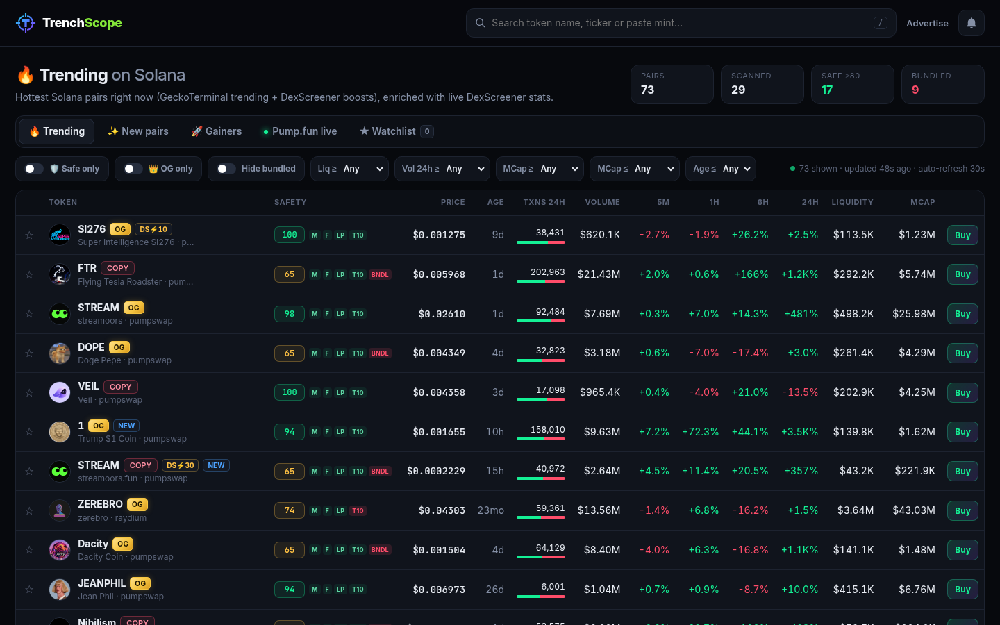
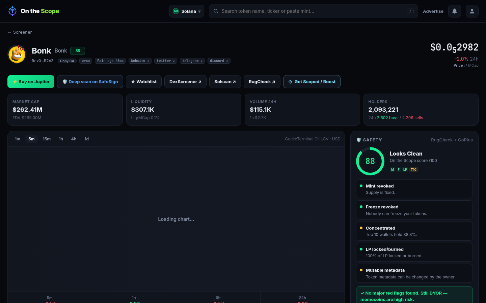
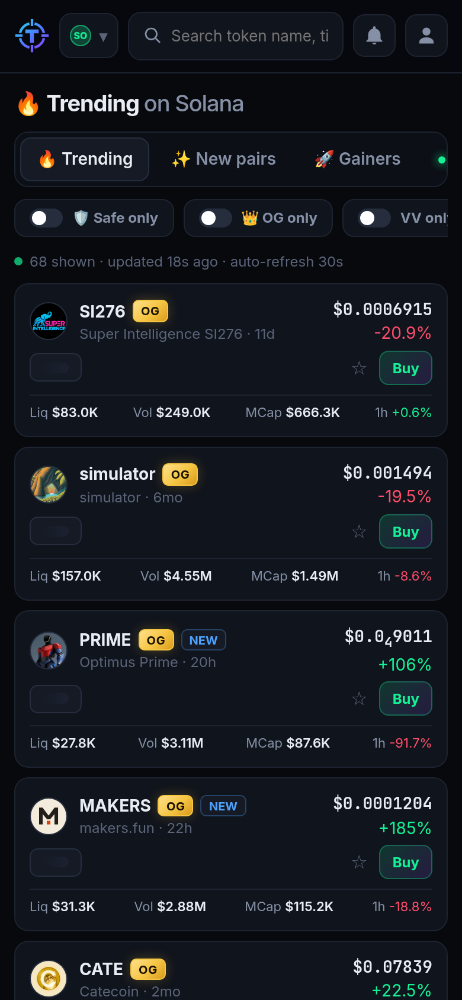

<p align="center"></p>

# TrenchScope

**The Solana screener that tells you if a token is a rug *before* you click it.**

DexScreener shows you charts. TrenchScope shows you charts **plus a safety score on every single row** — mint/freeze authority, LP lock, real holder concentration, dev wallet and bundle/sniper detection — so you can filter the trenches down to tokens that aren't obvious traps.

> **Why the name?** "The trenches" is what Solana memecoin traders call the low-cap, high-risk market. A *scope* lets you see what's in there before you jump in. Short, memorable, and it says what the product does.



<p> </p>

## What makes it better than DexScreener

| | DexScreener | TrenchScope |
|---|---|---|
| Trending / new / gainers tables | ✅ | ✅ with liquidity · volume · mcap · age filters |
| Safety score on every row | ❌ | ✅ 0–100 badge + M / F / LP / T10 / BNDL pips |
| "Safe only" & "Hide bundled" toggles | ❌ | ✅ |
| Holder concentration (excluding pools/lockers) | ❌ | ✅ top-10 % + top holders bars |
| Dev wallet intel | ❌ | ✅ creator, % of supply held, SOL balance |
| Bundle / sniper heuristic | ❌ | ✅ linked-wallet clusters from RugCheck's transfer graph |
| Pump.fun live coins | ❌ | ✅ |
| OG vs VAMP tags for reused names | ❌ | ✅ 👑 OG badge, “VAMP” chip + “Vamp of X ↗” link, OG-only filter |
| Enhanced token info | $299 | **On the Scope** $69 |
| Boosts | ~$99–$899 | $19 / $49 / $129 |
| Watchlist + price alerts | account needed | ✅ in-browser (localStorage + notifications), no login |
| One-click buy | ❌ | ✅ Jupiter, plus SafeSign deep scan |

## Features
- **Tables:** 🔥 Trending (GeckoTerminal trending pools + DexScreener boosts), ✨ New pairs (GeckoTerminal new pools + new DexScreener profiles), 🚀 Gainers (24h movers with ≥$5K liquidity), 🟢 Pump.fun live, ★ Watchlist. Sortable columns, 30s auto-refresh, filters persisted locally.
- **Safety score** (`lib/safety.js`, logic evolved from SafeSign's scanner): penalises active mint/freeze authority, concentrated top-10 holders (pools, lockers and burn accounts excluded), unlocked LP, large dev holdings, insider/bundle clusters, transfer fees, RugCheck "rugged" status and GoPlus flags (non-transferable, balance-mutable, closable). Any token with live mint/freeze authority or a bundle signal is capped at 65 so it can never show as "safe".
- **Token page:** TradingView lightweight-charts candlesticks (1m→1d) with volume, price/mcap/FDV/liquidity/volume/holders, 5m/1h/6h/24h change, live recent trades (wallet + tx links), all pools, safety flags, bundle check, dev wallet, holder bars, price alert form.
- **Search:** name, ticker or paste a mint (`/` to focus, arrow keys to navigate).
- **Quick links:** Jupiter, SafeSign (`https://safesign-pg8h.onrender.com`), DexScreener, Solscan, RugCheck, pump.fun.
- **Server-side caching:** every upstream call goes through a TTL cache with in-flight de-duplication, stale-on-error fallback, per-host throttling (GeckoTerminal ≈ 50/min) and retry on 429/5xx. Safety scans run in a background queue (2 workers) so tables load instantly and badges fill in.

## 👑 OG vs VAMP (`lib/og.js`)
When a coin pumps, vamps relaunch the same name/ticker. TrenchScope finds every Solana token with the same identity and marks the **first one to graduate** as **OG**; later ones get a **VAMP** tag (“Vamp: reused a name that already graduated earlier”) that links to the OG.
- **Normalization:** lowercase, accents/emojis/`$`/punctuation/spaces stripped, leading “the”, one trailing suffix (`coin`, `token`, `official`, `sol`, `onsol`, `fun`, `ai`) removed — `streamoors.fun` = `Streamoors`, `The BONK Coin 🚀` = `bonk`.
- **Same identity:** same normalized name, or same ticker AND one name contains the other (so `Streamflow` ≠ `streamoors` even though both are `STREAM`).
- **Candidates:** DexScreener search by name and by ticker, then *all* pairs of every candidate via `/tokens/v1`.
- **Graduation time:** earliest Raydium or PumpSwap pair (`pairCreatedAt`) — where pump.fun coins migrate when the curve completes. Earliest graduate = OG.
- Only migrated tokens are tagged: anything still on the pump.fun bonding curve (no PumpSwap/Raydium pair) gets no OG/VAMP tag.
- **VV (Valid Vamp):** a VAMP whose smoothed market cap (median of ≥3 samples over 4h, spanning ≥1h) is ≥5x the OG's and that is ≥24h old gets a green/gold **VV** chip (“Valid Vamp: flipped the OG 5x+”); the OG page shows “Flipped by …”. Dynamic — lost when it falls back under 5x. Mcap samples come from list refreshes and a 10-min background sampler.
- Results are cached persistently in `data/og-cache.json` (6h TTL) and computed in a background queue.
- Real example (verified 16 Oct 2026): trending **FTR “Flying Tesla Roadster”** (`DFMt…pump`, PumpSwap 14 Oct) is marked **Vamp of FTR `3w5c…`**, which had a Raydium pair since 14 Aug 2026.

## 💸 Monetization (Solana Pay, USDC or SOL)
| Product | Price | DexScreener |
|---|---|---|
| **On the Scope** — logo, banner, description, website/X/Telegram + crosshair “On the Scope” badge, reviewed before going live | $69 one-time | $299 Enhanced Token Info |
| ⚡ 10x Boost | $19 / 12h | ~$99 / 12h* |
| ⚡ 30x Boost | $49 / 24h | ~$249 / 12h* |
| ⚡ 100x Boost | $129 / 24h | ~$899 / 24h* |

\*commonly reported prices; DexScreener only shows boost prices in its own dialog.
- Buyers order on **/advertise** → get Solana Pay QR codes / wallet links (USDC exact amount, or SOL quoted live and valid 1h) → `/order/:id` polls and verifies on-chain.
- **No private keys.** Each payment option has a unique `reference` pubkey; the server looks up transactions with it via public RPC and checks the owner wallet’s USDC/SOL balance delta (logic adapted from SafeSign). A signature can only pay one order.
- Boosts activate instantly, pin the token higher in Trending (ordered by active boosts) and are labelled **⚡ Promoted / AD**. DexScreener’s own boosts are shown separately as **DS⚡**. Boosts are refused for tokens our scanner rates high-risk.
- On the Scope orders go to **review**; the owner approves/rejects at **/admin** (`ADMIN_PASSWORD` env, timing-safe compare, lockout after 10 failures). Only approved info is shown.
- Orders persist in `data/orders.json` (`ORDERS_FILE` to change).

## Data sources (all free, no keys)
DexScreener (`/tokens/v1`, `/latest/dex/search`, token-boosts, token-profiles) · GeckoTerminal (trending/new pools, OHLCV, trades) · pump.fun frontend API · RugCheck report API · GoPlus Solana token security · Solana public RPC (`getBalance`). Nothing shown in the UI is invented — when a source has no value the UI shows "—".

## Run
```bash
npm install
npm start          # http://localhost:3000  (PORT env to change)
npm test           # payment verification (real historical txs) + OG tests + live API smoke test
```
Env: `SOLANA_RPC` (default public mainnet RPC), `ADMIN_PASSWORD` (enables /admin), `PAY_WALLET` (owner wallet, default `EL63Jz5kAamGAFtwiunvCJsFcAZWGUmagPTHZTrcPVv6`), `ORDERS_FILE`, `OG_CACHE_FILE`.

## Deploy (Render free)
Push the repo, then **New → Blueprint** in Render and select it — `render.yaml` sets up a free Node web service with a `/api/health` check.

## Limitations
- Bundle/sniper detection is a heuristic built on RugCheck's insider-network data, not an analysis of first-block buys.
- "Other tokens created" by the dev only shows when RugCheck reports it.
- Gainers are computed over the tracked universe (trending + new + boosted), not every Solana pair.
- Pump.fun's frontend API is unofficial and may change or block datacenter IPs.
- Free public APIs rate-limit; on a busy instance safety badges may take a minute to fill in.
- Alerts only fire while a TrenchScope tab is open (no push server).
- OG detection only sees tokens DexScreener search returns (~30 pairs per query); very common names may miss older tokens. Raydium pairs are treated as graduations even for tokens launched directly on Raydium. pump.fun's search API ignores the search term from servers, so it isn't used.
- **Render free has no persistent disk:** `data/orders.json` and the OG cache are wiped on redeploy/restart. For real sales, attach a Render disk (paid) or point `ORDERS_FILE` to persistent storage, and back up orders. On-chain payments themselves are never lost — an order can be re-verified from its reference.
- On the Scope assets are submitted as https URLs (no file upload/hosting); rejected-order refunds are manual.
- Not financial advice. Scores are heuristics.

MIT licensed.
